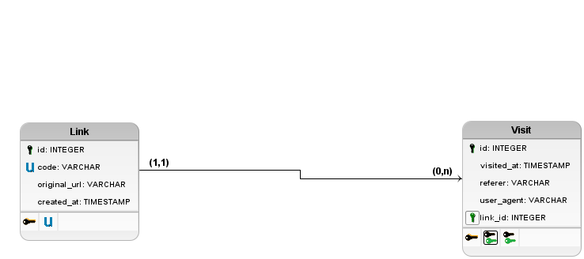

# URL Shortener

A URL shortener lets the user submit an original link and receive a shorter one, useful for posts, for example, since the original link is too long.

## Status

| Session | Scope | Status |
|---|---|---|
| S1 | Data model, use cases, repository | ✅ Done |
| S2 | Spring Boot project, PostgreSQL on Docker, `POST /links` | ✅ Done |
| S3 | `GET /{code}` redirects to the original URL | ⏳ Next |
| S4 | Click tracking + statistics per day | ⏳ Planned |
| S5 | Front-end: form and link list (fetch + CORS) | ⏳ Planned |
| S6 | Front-end: statistics page + release v1.0 | ⏳ Planned |

## Tech stack

- **Java 21**
- **Spring Boot 4** (Web MVC, Data JPA, Validation)
- **PostgreSQL 16**, running in **Docker** via Docker Compose
- **Maven** (wrapper included, no local install needed)

## Data model



## Use cases

- **Owner**: creates a short link from an original URL and receives the generated short link
- **Visitor**: accesses the short link; the system records the visit and the visitor is redirected to the original site
- **Owner**: views the statistics of a link and receives the total number of clicks and the clicks per day
- **Owner**: lists the short links in the system and receives the list of available short links

## Running locally

### Prerequisites

- JDK 21
- Docker Desktop (or Docker Engine + Compose)

### 1. Start the database

```bash
docker compose up -d
```

This starts a PostgreSQL 16 container named `encurtador-db`, exposed on **port 3245** of your machine. Data is kept in the `pgdata` volume, so it survives container restarts.

### 2. Start the application

```bash
# Linux / macOS / Git Bash
./mvnw spring-boot:run

# Windows (CMD / PowerShell)
mvnw.cmd spring-boot:run
```

The API starts at `http://localhost:8080`. Hibernate creates the `links` table automatically on the first run (`ddl-auto=update`).

> The database credentials in `docker-compose.yaml` and `application.properties` are for **local development only**.

## API

### Create a short link

`POST /links`

**Request body**

```json
{
  "url": "https://www.example.com/a/very/long/path?with=query&params=true"
}
```

**Response: `201 Created`**

The `Location` header points to the new short URL.

```json
{
  "code": "aB3xK9p",
  "urlOriginal": "https://www.example.com/a/very/long/path?with=query&params=true",
  "urlCurta": "http://localhost:8080/aB3xK9p",
  "criadoEm": "2026-10-20T22:10:00Z"
}
```

**Response: `400 Bad Request`**

Returned when `url` is blank or is not a valid URL.

**Try it with curl**

```bash
curl -i -X POST http://localhost:8080/links \
  -H "Content-Type: application/json" \
  -d '{"url":"https://www.example.com/a/very/long/path"}'
```

## How the short code is generated

- **7 random characters** from a 62-symbol alphabet (`a-z`, `A-Z`, `0-9`), which gives 62⁷ ≈ 3.5 trillion combinations.
- Uses `SecureRandom`, so codes are not predictable from previous ones.
- Before saving, the service checks whether the code already exists (`existsByCode`). If it does, it tries again, **up to 5 attempts**.
- The `code` column is also `UNIQUE` in the database, as a final safety net.

## Project structure

```
src/main/java/br/com/encurtador/encurtador/
├── EncurtadorApplication.java   # Spring Boot entry point
└── link/                        # package-by-feature
    ├── Link.java                # JPA entity (table "links")
    ├── LinkRepository.java      # Spring Data JPA repository
    ├── LinkService.java         # business rules: code generation, saving
    ├── LinkController.java      # REST endpoint POST /links
    ├── CriarLinkRequest.java    # input DTO (record) with validation
    └── LinkResponse.java        # output DTO (record)
```

## Author

**Guilherme Fontes**, [@guilhermefontesdev](https://github.com/guilhermefontesdev)
